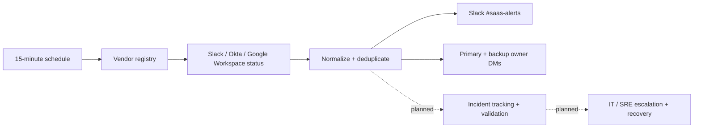

# 🧠 AI Automation Lab


Projects that use AI and automation to make IT operations faster, safer, and easier to run, with a human kept in the loop wherever a decision matters.

---

## Featured architecture · SaaS Incident Intelligence

A concrete example of translating enterprise IT operations into a **tested, event-driven workflow**. The currently implemented Phase 1 monitors vendor status sources, normalizes and deduplicates updates, and sends targeted Slack alerts. Jira/ServiceNow incident management and on-call escalation are documented designs for later phases.



**Explore the implementation:** [Architecture and operations guide](projects/saas-incident-intelligence/README.md) · [Importable n8n workflow](projects/saas-incident-intelligence/workflow/phase1-detection.json) · [Synthetic lifecycle tests](projects/saas-incident-intelligence/tests/phase1.test.js)

**How to try the pilot**

1. Download the JSON above and import it into n8n.
2. In **Load Application Registry**, replace sample Slack user IDs with test-workspace user IDs.
3. Create a test `#saas-alerts` channel and attach a Slack credential to the alert and DM nodes.
4. Start with a test workspace and review the existing safeguards before activating the 15-minute schedule.

Run the repository's code-node validation and test suite without live SaaS credentials:

```bash
python scripts/validate_workflows.py
node --test $(find projects -name '*.test.js')
```

**Demo evidence:** The Mermaid diagram is generated from the documented workflow. Actual n8n canvas and Slack screenshots should be captured from a sanitized test workspace; no live-tenant screenshots are included here. The pilot is not a production-ready incident-response platform without deployment-specific configuration, credential handling, fallback communications, and operational testing.

---

## 📂 In this repo

### 🔹 [Enterprise SaaS Incident Intelligence & Automated Response](projects/saas-incident-intelligence/README.md)

**Status:** Phase 1 (detection) built as a tested n8n workflow. Phases 2–3 designed.

An n8n + Slack pipeline that watches SaaS vendor status feeds, separates vendor-reported severity from verified internal impact, routes incidents to the right application owner, drafts approved communications, escalates to SRE/on-call, and keeps one deduplicated record in Jira or ServiceNow.

- **Working Phase 1 workflow:** polls Slack, Okta, and Google Workspace status feeds every 15 minutes, deduplicates, posts to `#saas-alerts`, and DMs app owners about major incidents
- 15 tests replay a full incident lifecycle (new, repeat, resolved, disappeared, feed outage) against synthetic vendor feeds, run in CI
- Mermaid architecture covering detection, triage, owner validation, and recovery
- Internal P1–P4 priority policy that doesn't treat a vendor "major outage" as an automatic P1
- Deduplication and idempotency design so one vendor incident never opens two tickets
- Security controls: vendor feed text treated as untrusted input, signed Slack actions, least-privilege credentials
- Phased rollout plan and testable acceptance criteria

---

## 🏢 Built at work (not public)

These were built for an employer, so the code stays private. I'm happy to walk through the design in an interview.

### 🔹 ChatGPT IT Triage Agent
An AI assistant that collects user context, asks guided support questions, and triages IT requests.
- Reduces manual triage time by up to 50%
- Improves first-response accuracy and data gathering
- Integrates with internal APIs and support channels

### 🔹 Change & Incident Request Assistant
A custom GPT that turns natural-language descriptions into structured change and incident requests.
- Standardizes request submissions
- Reduces ticket creation time
- Speeds up response and approval workflows

---

## 🔗 Related public work

| Project | What it shows |
|---|---|
| [n8n-shop](https://github.com/Mrandrew9/n8n-shop) | Tested, CI-validated n8n workflows: GDPR data subject requests, IAM access approval |
| [Prompt-Engineering CI/CD](https://github.com/Mrandrew9/Prompt-Engineering-) | LLM prompts with schema validation, tests, and evals in GitHub Actions |
| [slack-scim-api-groups](https://github.com/Mrandrew9/slack-scim-api-groups) | Slack SCIM group lifecycle as a Postman collection |

---

## 🧩 Tech stack

| Category | Tools & platforms |
|---|---|
| AI & automation | OpenAI API, Custom GPTs, n8n |
| Scripting & APIs | Python, Postman |
| Identity & security | Okta, SCIM, SAML |
| Collaboration | Slack, Workflow Builder |
| Infrastructure | AWS, GCP, VMware, Jamf |

---

## 🧭 Next

- Incident intelligence Phase 2: Jira/ServiceNow incident upsert and interactive Slack acknowledgment
- Incident intelligence Phase 3: Slack-independent fallback alerts and detection-latency metrics

---

## 📫 Connect

I'm **Andrew Yonan**, an IT Systems Engineer working on identity, SaaS automation, and AI-assisted IT operations.

- **LinkedIn:** [linkedin.com/in/Andrew-Yonan](https://linkedin.com/in/Andrew-Yonan)
- **GitHub:** [github.com/Mrandrew9](https://github.com/Mrandrew9)

> *AI should augment, not replace, human expertise. I build systems that help people work smarter, move faster, and stay secure.*
