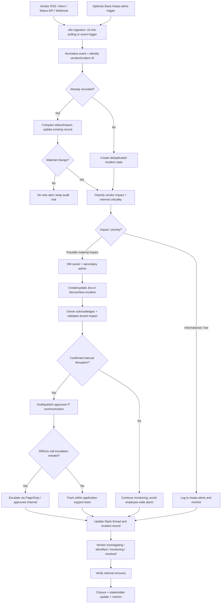

# Enterprise SaaS Incident Intelligence & Automated Response

> **Status:** Proposed solution architecture (not deployed)  
> **Primary technologies:** n8n, Slack, SaaS vendor status feeds/APIs, Jira or ServiceNow, SRE/on-call tools  
> **Purpose:** Reduce time to detect, route, communicate, track, and resolve third-party SaaS incidents.

## Executive summary

Enterprise IT teams depend on many SaaS vendors, but vendor status notifications can become noisy, scattered, or hard to route to the correct application owner. This design proposes a centralized detection and response pipeline that ingests vendor-reported incidents, assesses potential internal impact, notifies accountable owners, prepares user communications, alerts SRE where necessary, and creates or updates an incident record.

**Design principle:** Monitor vendor sources directly in n8n wherever possible; use Slack's `#saas-alerts` channel as a visibility and collaboration layer, not as the only system of record. A Slack-triggered ingestion path may supplement direct monitoring.

**Important distinction:** A vendor-reported “major outage” does **not** necessarily mean an internal P1. Internal priority depends on enterprise tenant, geography, feature criticality, and verified user impact.

## Objectives

1. Detect vendor-reported interruptions using RSS/Atom feeds, structured status APIs, and webhooks.
2. Poll sources every **15 minutes** by default, accepting that detection latency may be up to the interval plus processing time; use webhooks for faster vendor-supported events.
3. Normalize events, correlate updates to existing vendor incident IDs, and suppress duplicate alerts.
4. Identify primary SaaS owners, secondary admins, and support groups.
5. Triage vendor severity against *internal* service impact and business criticality.
6. Notify application owners and admins via targeted Slack DMs.
7. Draft appropriate IT/internal-user communications, requiring approval where impact is unverified or the message is broad.
8. Notify incident response/SRE/on-call for qualifying high-priority incidents.
9. Create or update a **ServiceNow Incident** or incident-type Jira issue, rather than opening duplicate requests.
10. Track the incident through restoration, confirmation, and closure.
11. Collect detection, acknowledgment, routing, and noise-reduction metrics.

## Architecture



### Recommended components

| Component | Responsibility |
|---|---|
| Vendor status feed/API | Source for vendor-authored advisories, affected components, status transitions, and incident links |
| n8n | Polling/event ingestion, normalization, routing, branching, integrations, and error handling |
| Durable incident state | Unique incident key, last status, last notification, Slack thread, ticket ID, acknowledgments |
| Application ownership registry | Maps vendor/application to owner, admin, criticality, components, and escalation policy |
| Slack `#saas-alerts` | Centralized operational visibility; raw/filtered advisories and updates |
| Slack DM / IT announcement channel | Accountable team notifications and user-facing notices |
| Jira or ServiceNow | Incident tracking, assignment, audit history, resolution record |
| SRE/on-call platform | Escalation for validated high-impact events; alternate path when Slack is impaired |

## Workflow A — Detect and normalize

**Trigger:** n8n Schedule Trigger every 15 minutes, or vendor webhook. A Slack Trigger listening for RSS posts in `#saas-alerts` is an optional fallback, not the recommended sole intake.

**Processing steps:**

1. Read each enabled feed or status endpoint in the application registry.
2. Parse vendor name, title, URL, incident ID when available, published/updated time, incident state, severity/impact, affected components/regions, and original event text.
3. Normalize vendor-specific fields into a common event schema.
4. Derive the deduplication key from `vendor_id + vendor_incident_id`. When no durable ID exists, use a conservative canonical-URL or content-hash fallback and do **not** assume updates necessarily represent the same incident.
5. Look up the incident state. For existing records, compare materially relevant fields (status, impacted components, severity, or a meaningful new vendor update).
6. Ignore unchanged repeats; record audit events as needed.
7. Send new/materially changed events to Workflow B.

**Example normalized payload** (illustrative, not a real incident):

```json
{
  "vendor_id": "slack",
  "vendor_incident_id": "example-incident-123",
  "incident_key": "slack:example-incident-123",
  "title": "Messaging service degradation",
  "vendor_status": "investigating",
  "vendor_impact": "major",
  "affected_components": ["messaging"],
  "regions": [],
  "source_url": "https://status.slack.com/",
  "published_at": "2026-11-09T15:00:00Z",
  "internal_impact": "unconfirmed",
  "internal_priority": "triage_required"
}
```

**n8n node outline:** Schedule Trigger → registry lookup → HTTP Request / RSS parser → Code (normalization) → Data Table / database lookup → IF/Switch (new or material change) → Execute Sub-workflow.

If using native RSS polling, configure schedules per vendor feed. For Statuspage-style APIs, prefer structured incidents/impact/components over keyword-only RSS severity classification. Avoid relying solely on words such as “down” or “outage.”

## Workflow B — Triage, route, and communicate

### Priority policy

Vendor impact is an input; **internal priority requires enterprise-specific evidence**.

| Priority | Internal assessment | Default action |
|---|---|---|
| **P1 — Critical** | Widespread, confirmed failure of a business-critical service with major business impact | Immediate owner/admin + incident commander + SRE/on-call, tracked incident, approved employee alert |
| **P2 — High** | Confirmed material degradation of a critical service, or urgent high-risk event under active validation | Owner/admin, ticket, targeted IT updates, SRE if dependency warrants |
| **P3 — Medium** | Localized or minor issue; limited/no confirmed business effect | Owner notification, ticket or log according to policy, monitor |
| **P4 — Informational** | Maintenance or advisory with negligible internal impact | Log in `#saas-alerts`; no broad paging |

**Proposed response targets (tune to policy):** Ask the service owner to acknowledge potentially severe events within five minutes; escalate an unacknowledged high-impact event after 15 minutes. These are *proposal parameters*, not vendor SLAs or guaranteed response times.

### Owner validation gate

For a serious vendor event:

1. Identify primary owner and secondary admin using the registry.
2. DM both with affected service, vendor impact, known components, source link, tracking record, and clear “internal impact not yet confirmed” wording.
3. Provide actionable Slack controls: **Acknowledge**, **Impact confirmed**, **Investigating**, **No internal impact**, and **Escalate**.
4. Validate any Slack button action with signed requests and an authenticated mapping between Slack users and authorized application owners.
5. Record decisions with actor, timestamp, and evidence.
6. Draft an IT advisory, but require human approval for broad employee messaging unless a pre-approved policy explicitly authorizes automatic publication.
7. Alert SRE/on-call only for qualifying internal priority or confirmed critical dependencies.

If the owner is unavailable or does not acknowledge by the configured threshold, route to secondary admin or the designated on-call service. If Slack itself is affected, use a communication path independent of Slack.

### Jira / ServiceNow tracking

Prefer creating **ServiceNow Incidents** for unplanned service disruptions, or the organization's designated incident-type Jira issues. Do not create a generic service request for every outage.

Persist:
- Incident key and vendor incident ID
- Source URL and affected components
- Vendor status/impact vs. independently assessed internal severity
- First detected, last vendor update, owner acknowledged, internal restored, and closed timestamps
- Assigned support group and service/CI reference (if CMDB-backed)
- Slack incident thread identifier and external ticket identifier
- Communication approvals, escalation, decision log, and closure notes

**Idempotency:** Upsert on the incident key; use concurrency-safe persistence/locking so simultaneous n8n executions cannot create duplicate tickets. Reuse existing Slack threads.

## Workflow C — Track updates and verify recovery

1. Read vendor updates and match them to active incident keys.
2. For `investigating`, `identified`, or material `monitoring` changes, update the existing record and relevant Slack thread.
3. Suppress repetitive informational updates unless substantial new impact or remediation guidance appears.
4. When the vendor declares `resolved`, alert the service owner to validate enterprise tenant functionality.
5. If users are still affected, keep the internal incident open and continue investigating independently.
6. On confirmed internal recovery, post a closure update, record duration and resolution evidence, and transition the incident appropriately.
7. Capture follow-ups for missed detections, escalation delays, or communications errors.

**Do not infer resolution** solely because an incident disappeared from an API's open-incident listing.

## Application registry

Maintain the following in ServiceNow CMDB, a durable database, or n8n Data Tables for a pilot.

| Field | Purpose |
|---|---|
| `vendor_id` / `application_name` | Stable identity |
| `business_criticality` | Critical/high/medium/low |
| `status_source_type` and `status_source_url` | RSS, Atom, Status API, webhook |
| `primary_slack_user_id` / `secondary_slack_user_id` | DM routing |
| `assignment_group` and `sre_escalation_policy` | Ticket and on-call routing |
| `affected_components` / `regions` | Relevant impact boundaries |
| `incident_system` / `configuration_item` | Jira or ServiceNow routing |
| `enabled` / `last_successful_poll` | Operational control and health |

**Initial pilot applications:** Slack, Okta, and Google Workspace. Expand to Asana, Miro, OpenAI, and other critical SaaS applications after confirming usable vendor status sources and relevant ownership mappings.

## Notification templates

### Owner/admin DM — impact pending

> 🚨 **SaaS Vendor Incident Detected — Action Required**  
> **Application:** {application}  
> **Vendor-reported severity:** {vendor_impact}  
> **Issue:** {vendor_summary}  
> **Status:** {vendor_status}  
> **Internal impact:** Not yet confirmed  
> **Action:** Please verify enterprise-user impact and acknowledge.  
> **Vendor source:** {source_url}  
> **Tracking ticket:** {incident_url}

### IT operations channel — advisory

> ⚠️ **IT Service Advisory — {application}**  
> **Vendor report:** {vendor_summary}  
> **Status:** {vendor_status}  
> **Internal impact:** {verified_impact_or_unconfirmed}  
> **IT action:** The application team is validating impact and monitoring the vendor.  
> **Next update:** {approved_update_time_or_condition}  
> **Vendor status:** {source_url}  
> **Internal incident:** {incident_url}

For unconfirmed impact, state that the issue is *vendor-reported* and do not imply affected internal users, root cause, or recovery ETA are confirmed.

### Incident response / SRE escalation

> 🚨 **SaaS Escalation — {application}, {internal_priority}**  
> **Internal impact:** {impact_evidence}  
> **Vendor status:** {vendor_status}  
> **Affected components:** {components}  
> **Owner:** {primary_owner}  
> **First detected:** {detected_at}  
> **Escalation reason:** {reason}  
> **Ticket / Slack thread / vendor source:** {links}

### Resolved notification

> ✅ **Service Update — {application}**  
> Vendor status: Resolved at {vendor_resolved_at}.  
> Internal service validation: {validated_or_pending}.  
> Affected users should report any continuing issues via {support_path}.  
> Tracking record: {incident_url}.

## Reliability, governance, and security controls

- **Avoid single-channel dependency:** Monitoring should not require Slack delivery. For Slack outages, use independent on-call/incident communications.
- **Fail visibly:** Detect stale feeds, failed API requests, malformed entries, n8n execution errors, authentication failures, and incident-system write failures.
- **Deduplicate and rate-limit:** Maintain a state store, lock on incident key, and throttle notifications to prevent alert storms.
- **Least privilege:** Use scoped Slack, n8n, Jira, and ServiceNow credentials. Keep credentials in a secure store; never commit secrets.
- **Audit trail:** Record normalized source data, routing decisions, owner acknowledgments, priority changes, communication approval, and escalation events.
- **Untrusted source content:** Treat RSS/status-feed text as untrusted. Sanitize content; do not let vendor text dictate tool actions or unauthorized Slack message destinations.
- **Approval and policy:** Require approval before employee-wide communications unless a documented policy defines exceptions.
- **Data minimization:** Do not expose customer/internal incident details in public status channels or third-party AI prompts.
- **No false certainty:** AI can help draft/summarize using validated facts, but it must not fabricate internal impact, root cause, or ETAs.
- **Recovery discipline:** Confirm internal service restoration separately from vendor “resolved.”
- **Test failure cases:** Duplicate events, out-of-order status transitions, vendor feed downtime, Slack outage, ticket API failure, owner not responding, and false positives.

## Implementation milestones

### Phase 1 — Pilot detection
- Stand up `#saas-alerts`.
- Register three pilot vendors and owners.
- Implement 15-minute poll (or webhook) with normalized events and deduplication.
- Send high-signal owner DMs.
- Test synthetic new, repeat, and resolved incidents.

### Phase 2 — Incident management
- Integrate Jira or ServiceNow incident creation/update.
- Add interactive Slack acknowledgment and approver workflow.
- Add internal impact assessment and severity rules.
- Add IT communications templates and SRE/on-call escalation.

### Phase 3 — Lifecycle, metrics, resilience
- Automatically thread updates and request recovery validation.
- Add independent fallback communications for Slack unavailability.
- Add runbooks, error alerts, and outage simulation tests.
- Report detection latency, owner acknowledgment, duplicate suppression, escalation accuracy, and closure completeness.

## Acceptance criteria

- [ ] Every enabled vendor is checked on schedule or via supported webhook.
- [ ] Duplicate source events do not create duplicate incident tickets or primary Slack messages.
- [ ] A new material vendor incident is routed to the configured primary and secondary owners.
- [ ] Vendor severity and internal impact are recorded separately.
- [ ] Employee-wide announcements require configured policy/approval gates.
- [ ] Confirmed P1 events reach the SRE/on-call path, including a Slack-independent fallback.
- [ ] Incident-state updates amend existing Slack threads and tickets.
- [ ] Vendor “resolved” does not silently close an internally active incident.
- [ ] Failure/timeout conditions create visible operational alerts.
- [ ] All integration credentials remain out of source control.

## Relevant documentation

- [n8n RSS Feed Trigger](https://docs.n8n.io/integrations/builtin/core-nodes/n8n-nodes-base.rssfeedreadtrigger/)
- [n8n Slack Trigger](https://docs.n8n.io/integrations/builtin/trigger-nodes/n8n-nodes-base.slacktrigger/)
- [Atlassian Statuspage APIs](https://support.atlassian.com/statuspage/docs/what-are-the-different-apis-under-statuspage/)
- [n8n Jira integration](https://n8n.io/integrations/jira-software/)
- [n8n ServiceNow + Slack integration](https://n8n.io/integrations/servicenow/and/slack/)

---

**Scope note:** This repository document is a design blueprint, not an exported or deployed n8n workflow. Connecting SaaS status sources, authenticating integrations, and implementing production-specific policies are required before operational use.
